# Ember evidence of U-74

Every row puts the Ember frame next to the React Native screen on the iOS 26.4 Simulator.

## core: Diary day (sheet, large detent)

| Ember frame | RN on the Simulator |
|---|---|
| 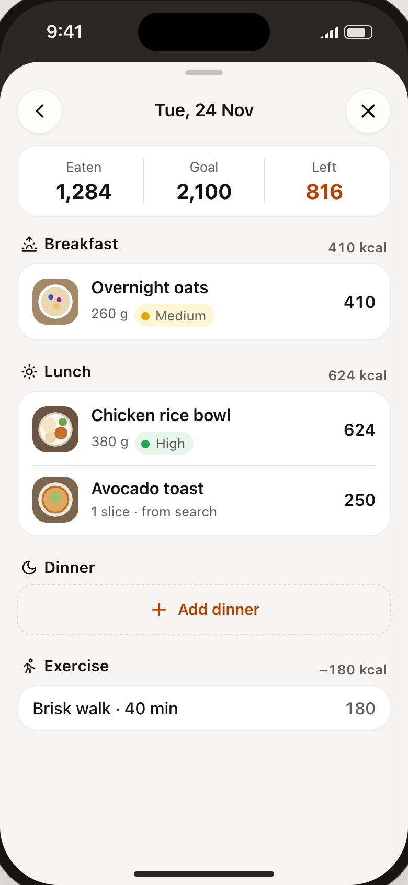 |  |

Frame: `docs/design/ember/frames/10-core-diary-day-sheet-large-detent.png`. Screenshot: `docs/rn-migration/evidence/DY-01/u74-diary-day-light.png`.
Deviations from the frame: Light, large detent, seeded Today. Rows show grams and the confidence badge or source beside kcal. Frame's status-bar clock overlaps nothing here. Meal icons are the DS Icon set..

## core: Diary day (sheet, large detent)

| Ember frame | RN on the Simulator |
|---|---|
|  |  |

Frame: `docs/design/ember/frames/10-core-diary-day-sheet-large-detent.png`. Screenshot: `docs/rn-migration/evidence/DY-01/u74-diary-day-dark.png`.
Deviations from the frame: Dark look from the tokens (Simulator appearance dark); the frame has no dark twin, so it is shown next to the light frame..

## profile: Food search (ED-Safe)

| Ember frame | RN on the Simulator |
|---|---|
| 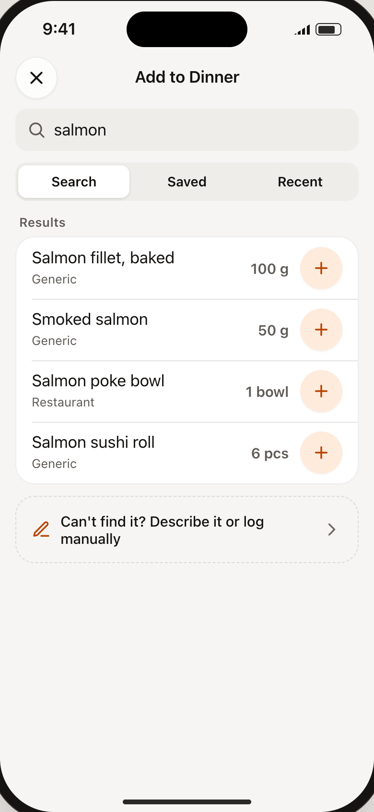 | 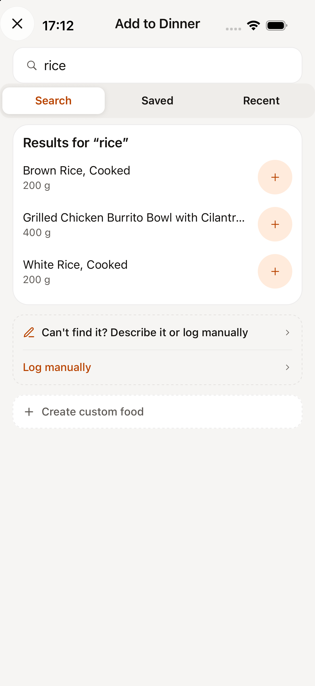 |

Frame: `docs/design/ember/frames/15-profile-food-search-ed-safe.png`. Screenshot: `docs/rn-migration/evidence/DY-03/u74-food-search-ed-light.png`.
Deviations from the frame: ED-Safe on (launch arg --ccEDSafe): Captured with the search-field fix applied locally (`docs/rn-migration/evidence/transcripts/u74e-compiler-fixes.patch`, not in this pull request); on the branch as it stands the search field accepts no typed text under React Compiler. Rows show serving or basis instead of kcal. The header (X, Add to Dinner) sits in the status-bar row (clock overlaps): safe-area defect not fixed in this unit. The Search/Saved/Recent segment is the feature's own control until design Segment lands. Three useEdSafeMode() reads stay because PR 54 (EdSafeAlternate) is not merged..

## darkmore: Food search (dark, ED-Safe)

| Ember frame | RN on the Simulator |
|---|---|
|  |  |

Frame: `docs/design/ember/frames/83-darkmore-food-search-dark-ed-safe.png`. Screenshot: `docs/rn-migration/evidence/DY-03/u74-food-search-ed-dark.png`.
Deviations from the frame: ED-Safe on, dark. Captured with the search-field fix applied locally (`docs/rn-migration/evidence/transcripts/u74e-compiler-fixes.patch`, not in this pull request); on the branch as it stands the search field accepts no typed text under React Compiler. Same deviations as the light row (status-bar overlap, own segment, PR 54 reads)..

## profile: Food search (ED-Safe)

| Ember frame | RN on the Simulator |
|---|---|
|  | 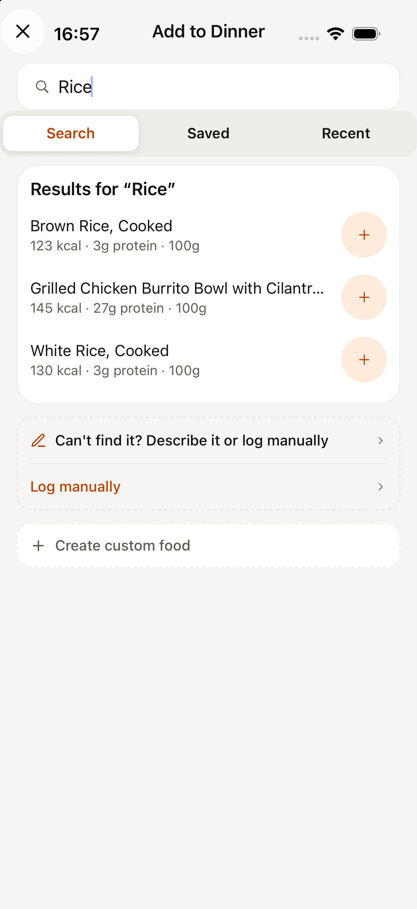 |

Frame: `docs/design/ember/frames/15-profile-food-search-ed-safe.png`. Screenshot: `docs/rn-migration/evidence/DY-03/u74-food-search-off-light.png`.
Deviations from the frame: ED-Safe off state (no frame of its own, shown next to the ED frame): Captured with the search-field fix applied locally (`docs/rn-migration/evidence/transcripts/u74e-compiler-fixes.patch`, not in this pull request); on the branch as it stands the search field accepts no typed text under React Compiler. kcal returns in the row slot. Same status-bar overlap as the ED row..

## profile: Manual log (ED-Safe)

| Ember frame | RN on the Simulator |
|---|---|
|  | 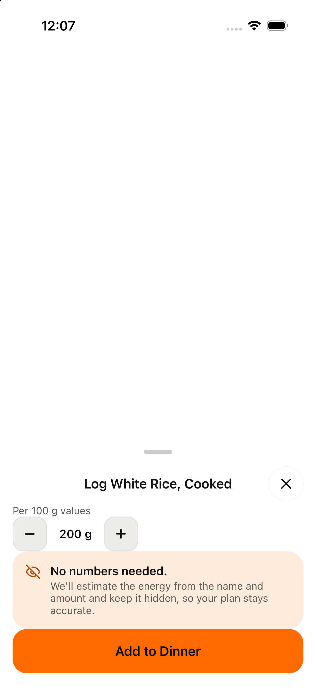 |

Frame: `docs/design/ember/frames/16-profile-manual-log-ed-safe.png`. Screenshot: `docs/rn-migration/evidence/DY-05/u74-manual-log-ed-light.png`.
Deviations from the frame: ED-Safe on: kcal field replaced by the note card 'No numbers needed.' Grams and Save stay. The first result tapped was Oats, Dry rather than White Rice (result order); the sheet is the same. The sheet is a bottom card with a blank area above it; the frame is a full-height screen. A native formSheet route or a scrim token is needed and design/** is forbidden. The Food/Exercise/Custom food segment of the frame is out of this unit..

## darkmore: Manual log (dark, ED-Safe)

| Ember frame | RN on the Simulator |
|---|---|
| 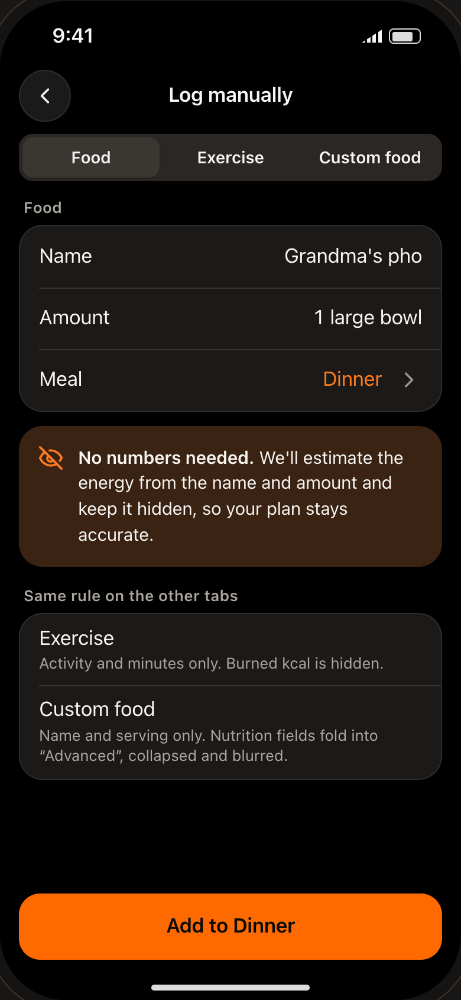 | 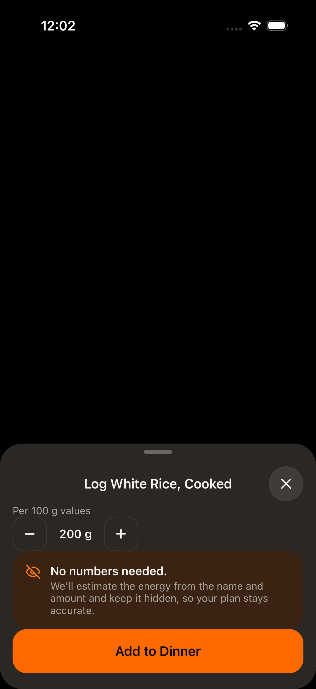 |

Frame: `docs/design/ember/frames/84-darkmore-manual-log-dark-ed-safe.png`. Screenshot: `docs/rn-migration/evidence/DY-05/u74-manual-log-ed-dark.png`.
Deviations from the frame: ED-Safe on, dark. The sheet is a bottom card with a blank area above it; the frame is a full-height screen. A native formSheet route or a scrim token is needed and design/** is forbidden..

## profile: Manual log (ED-Safe)

| Ember frame | RN on the Simulator |
|---|---|
|  | 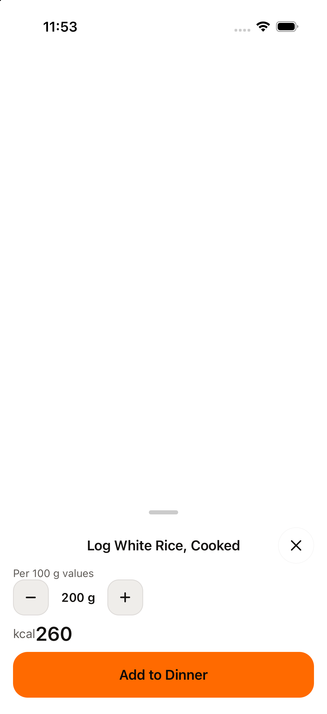 |

Frame: `docs/design/ember/frames/16-profile-manual-log-ed-safe.png`. Screenshot: `docs/rn-migration/evidence/DY-05/u74-manual-log-off-light.png`.
Deviations from the frame: ED-Safe off state: the kcal field is back (no frame of its own). The sheet is a bottom card with a blank area above it; the frame is a full-height screen. A native formSheet route or a scrim token is needed and design/** is forbidden..

## scan: Review (light)

| Ember frame | RN on the Simulator |
|---|---|
| 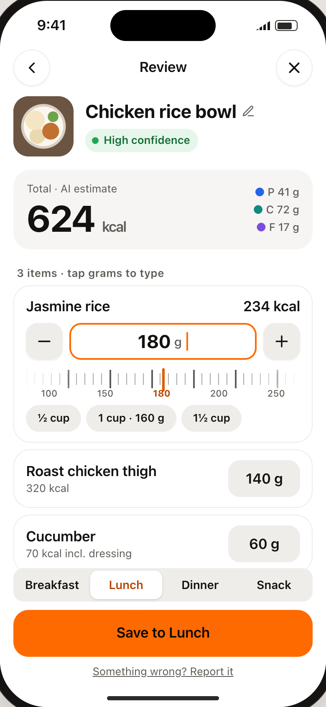 | 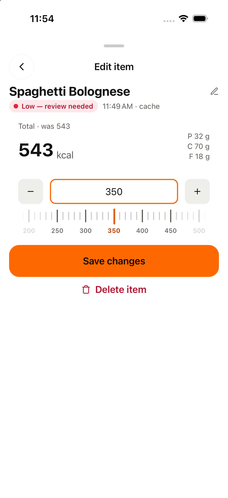 |

Frame: `docs/design/ember/frames/03-scan-review-light.png`. Screenshot: `docs/rn-migration/evidence/DY-08/u74-edit-light.png`.
Deviations from the frame: Edit item sheet next to the Review frame (frame 29 is the true target, see the 29 row). The sheet is a bottom card with a blank area above it; the frame is a full-height screen. A native formSheet route or a scrim token is needed and design/** is forbidden..

## diaryedit: Edit item (light)

| Ember frame | RN on the Simulator |
|---|---|
| 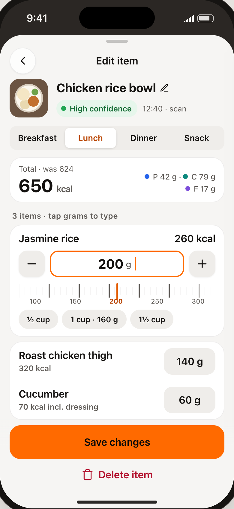 |  |

Frame: `docs/design/ember/frames/29-diaryedit-edit-item-light.png`. Screenshot: `docs/rn-migration/evidence/DY-08/u74-edit-light.png`.
Deviations from the frame: Edit item, light. Name, grams field with 44 pt steppers, ruler, kcal recomputed. The sheet is a bottom card with a blank area above it; the frame is a full-height screen. A native formSheet route or a scrim token is needed and design/** is forbidden..

## diaryedit: Edit item (dark)

| Ember frame | RN on the Simulator |
|---|---|
|  |  |

Frame: `docs/design/ember/frames/30-diaryedit-edit-item-dark.png`. Screenshot: `docs/rn-migration/evidence/DY-08/u74-edit-dark.png`.
Deviations from the frame: Edit item, dark. The sheet is a bottom card with a blank area above it; the frame is a full-height screen. A native formSheet route or a scrim token is needed and design/** is forbidden..

## diaryedit: Edit item (ED-Safe)

| Ember frame | RN on the Simulator |
|---|---|
| 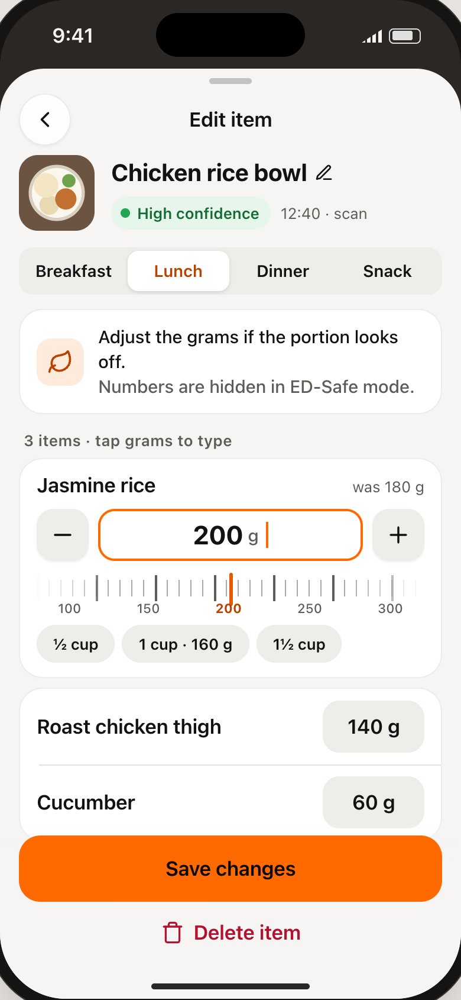 |  |

Frame: `docs/design/ember/frames/31-diaryedit-edit-item-ed-safe.png`. Screenshot: `docs/rn-migration/evidence/DY-08/u74-edit-ed.png`.
Deviations from the frame: Edit item, ED-Safe on: kcal hidden. The sheet is a bottom card with a blank area above it; the frame is a full-height screen. A native formSheet route or a scrim token is needed and design/** is forbidden. Three useEdSafeMode() reads stay (PR 54 not merged)..

## diaryedit: Delete confirm (light)

| Ember frame | RN on the Simulator |
|---|---|
| 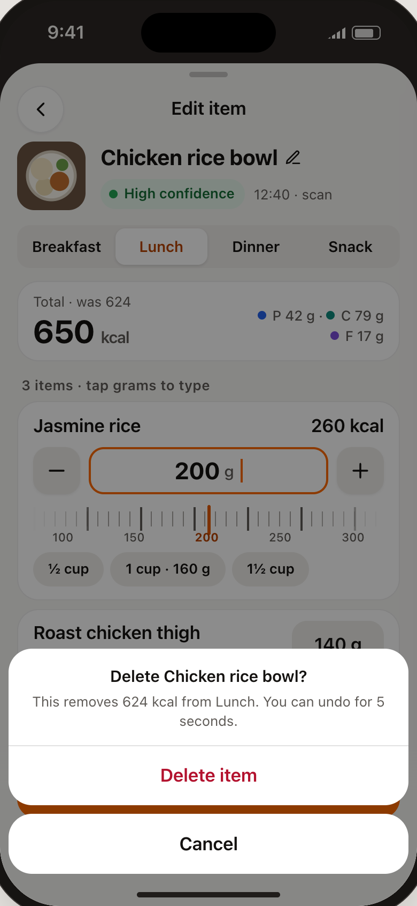 |  |

Frame: `docs/design/ember/frames/32-diaryedit-delete-confirm-light.png`. Screenshot: `docs/rn-migration/evidence/DY-08/u74-delete-light.png`.
Deviations from the frame: Delete confirm uses the system action sheet (ActionSheetIOS), not the frame's custom sheet; this is the decision of the brief. Copy: 'Delete <name>?' with 'Delete item' / 'Cancel'..

## diaryedit: Delete confirm (dark)

| Ember frame | RN on the Simulator |
|---|---|
|  |  |

Frame: `docs/design/ember/frames/33-diaryedit-delete-confirm-dark.png`. Screenshot: `docs/rn-migration/evidence/DY-08/u74-delete-dark.png`.
Deviations from the frame: Delete confirm, dark. System action sheet as in the light row..

## diaryedit: Delete confirm (ED-Safe)

| Ember frame | RN on the Simulator |
|---|---|
| 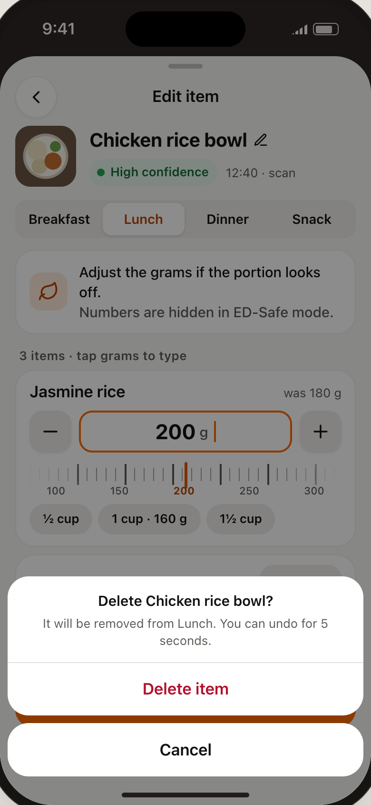 |  |

Frame: `docs/design/ember/frames/34-diaryedit-delete-confirm-ed-safe.png`. Screenshot: `docs/rn-migration/evidence/DY-08/u74-delete-ed.png`.
Deviations from the frame: Delete confirm, ED-Safe on. System action sheet; DEFECT seen on screen (review defect 2): under ED-Safe the confirmation reads 'This removes 543 kcal from Dinner.' (kcal shown). Not fixed here, the author corrects it on PR 37's branch..

## diaryedit: Saved (light)

| Ember frame | RN on the Simulator |
|---|---|
| 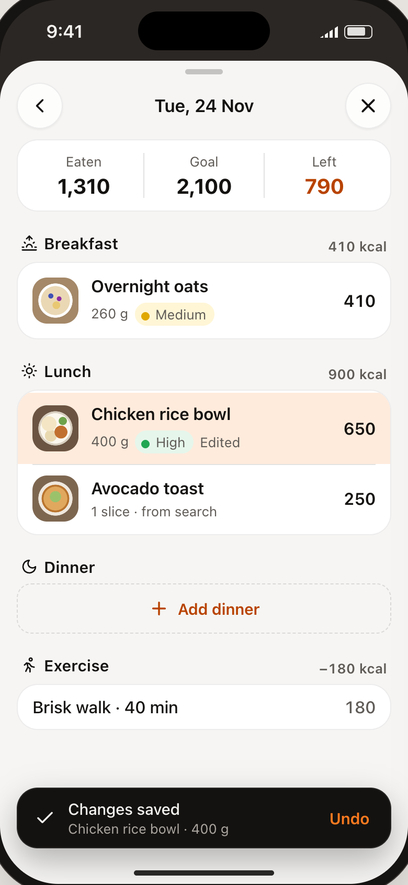 |  |

Frame: `docs/design/ember/frames/35-diaryedit-saved-light.png`. Screenshot: `docs/rn-migration/evidence/DY-08/u74-saved-light.png`.
Deviations from the frame: Saved with Undo (5 s toast); Dinner row 360 g / 559 kcal, totals 1,503 / 647. Captured with the two React Compiler fixes applied locally (`docs/rn-migration/evidence/transcripts/u74e-compiler-fixes.patch`); they are NOT in this pull request, so on the branch as it stands the day sheet keeps its pre-save rows after Save and Delete..

## diaryedit: Saved (dark)

| Ember frame | RN on the Simulator |
|---|---|
|  | 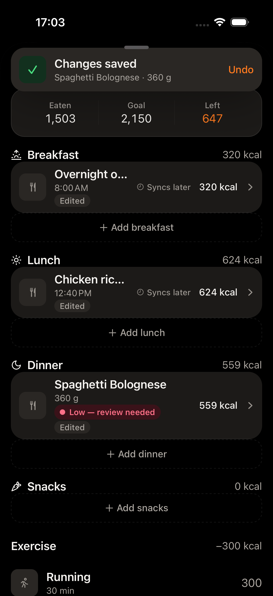 |

Frame: `docs/design/ember/frames/36-diaryedit-saved-dark.png`. Screenshot: `docs/rn-migration/evidence/DY-08/u74-saved-dark.png`.
Deviations from the frame: Saved with Undo, dark. Row 360 g / 559 kcal, Eaten 1,503. Captured with the two React Compiler fixes applied locally (`docs/rn-migration/evidence/transcripts/u74e-compiler-fixes.patch`); they are NOT in this pull request, so on the branch as it stands the day sheet keeps its pre-save rows after Save and Delete..

## diaryedit: Saved (ED-Safe)

| Ember frame | RN on the Simulator |
|---|---|
|  |  |

Frame: `docs/design/ember/frames/37-diaryedit-saved-ed-safe.png`. Screenshot: `docs/rn-migration/evidence/DY-08/u74-saved-ed.png`.
Deviations from the frame: Saved with Undo, ED-Safe on: no kcal figures in the sheet. Captured with the two React Compiler fixes applied locally (`docs/rn-migration/evidence/transcripts/u74e-compiler-fixes.patch`); they are NOT in this pull request, so on the branch as it stands the day sheet keeps its pre-save rows after Save and Delete. The toast sits over the top of the sheet and covers its summary card; the section headers are partly overlapped..

## diaryedit: Deleted + Undo (light)

| Ember frame | RN on the Simulator |
|---|---|
| 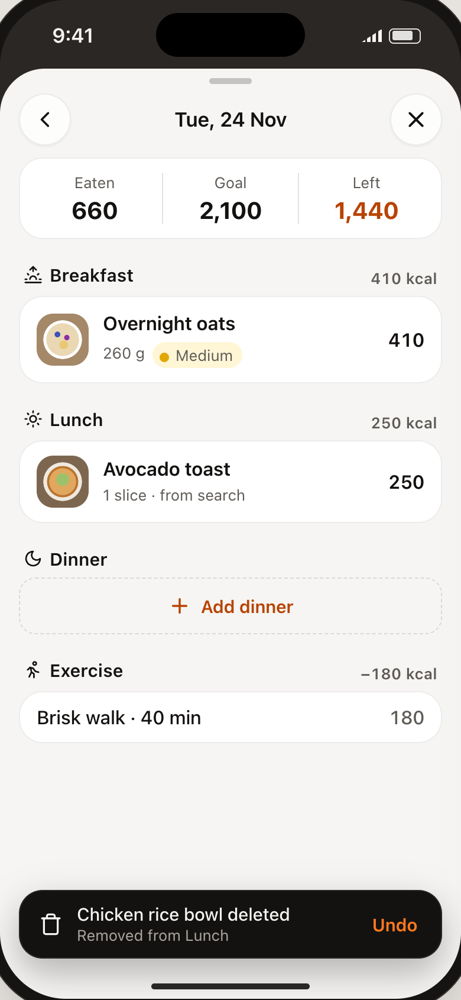 |  |

Frame: `docs/design/ember/frames/38-diaryedit-deleted-undo-light.png`. Screenshot: `docs/rn-migration/evidence/DY-08/u74-undo-light.png`.
Deviations from the frame: Deleted with Undo; Dinner row gone, Eaten 944, Left 1,206. Captured with the two React Compiler fixes applied locally (`docs/rn-migration/evidence/transcripts/u74e-compiler-fixes.patch`); they are NOT in this pull request, so on the branch as it stands the day sheet keeps its pre-save rows after Save and Delete..

## diaryedit: Deleted + Undo (dark)

| Ember frame | RN on the Simulator |
|---|---|
|  | 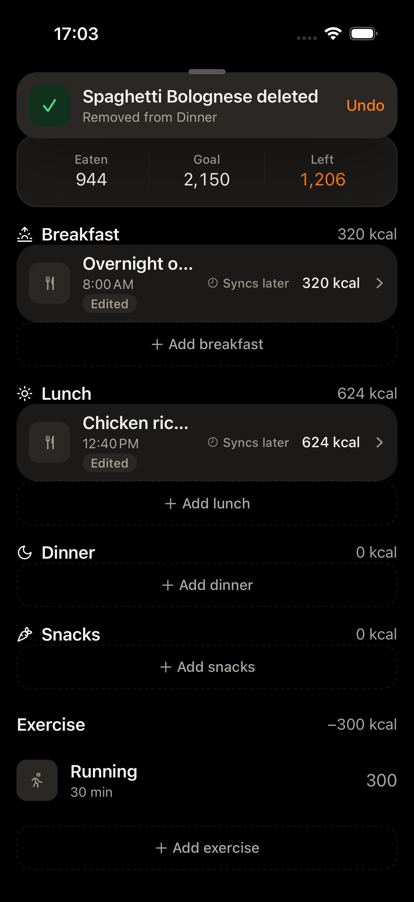 |

Frame: `docs/design/ember/frames/39-diaryedit-deleted-undo-dark.png`. Screenshot: `docs/rn-migration/evidence/DY-08/u74-undo-dark.png`.
Deviations from the frame: Deleted with Undo, dark. Captured with the two React Compiler fixes applied locally (`docs/rn-migration/evidence/transcripts/u74e-compiler-fixes.patch`); they are NOT in this pull request, so on the branch as it stands the day sheet keeps its pre-save rows after Save and Delete..

## diaryedit: Deleted + Undo (ED-Safe)

| Ember frame | RN on the Simulator |
|---|---|
|  |  |

Frame: `docs/design/ember/frames/40-diaryedit-deleted-undo-ed-safe.png`. Screenshot: `docs/rn-migration/evidence/DY-08/u74-undo-ed.png`.
Deviations from the frame: Deleted with Undo, ED-Safe on: no kcal figures. Captured with the two React Compiler fixes applied locally (`docs/rn-migration/evidence/transcripts/u74e-compiler-fixes.patch`); they are NOT in this pull request, so on the branch as it stands the day sheet keeps its pre-save rows after Save and Delete..

## profile: Manual log (ED-Safe)

| Ember frame | RN on the Simulator |
|---|---|
|  | 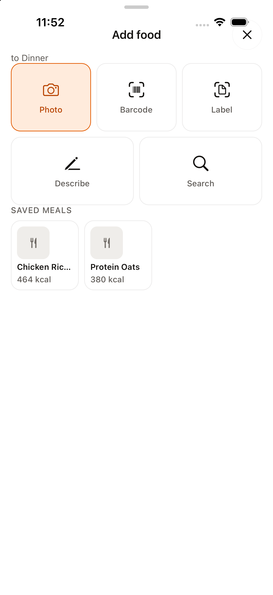 |

Frame: `docs/design/ember/frames/16-profile-manual-log-ed-safe.png`. Screenshot: `docs/rn-migration/evidence/DY-02/u74-add-food-sheet.png`.
Deviations from the frame: Add food (derived from the manual-log frame, the nearest frame with this chrome). Five quick-action tiles in the dashed style. The sheet is a bottom card with a blank area above it; the frame is a full-height screen. A native formSheet route or a scrim token is needed and design/** is forbidden..

## profile: Manual log (ED-Safe)

| Ember frame | RN on the Simulator |
|---|---|
|  | 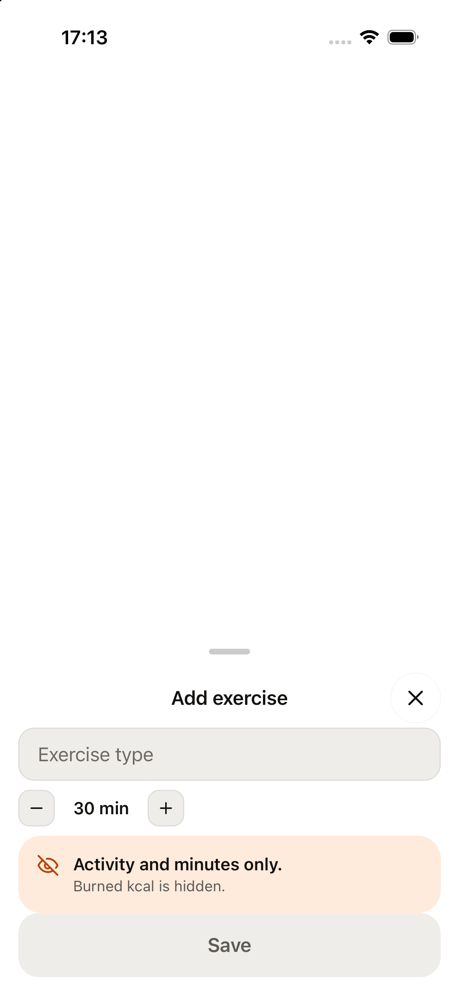 |

Frame: `docs/design/ember/frames/16-profile-manual-log-ed-safe.png`. Screenshot: `docs/rn-migration/evidence/DY-06/u74-exercise-ed-light.png`.
Deviations from the frame: Exercise log with ED-Safe on (derived from frame 16): kcal field hidden, note 'Activity and minutes only. Burned kcal is hidden.' The sheet is a bottom card with a blank area above it; the frame is a full-height screen. A native formSheet route or a scrim token is needed and design/** is forbidden..

## profile: Manual log (ED-Safe)

| Ember frame | RN on the Simulator |
|---|---|
|  |  |

Frame: `docs/design/ember/frames/16-profile-manual-log-ed-safe.png`. Screenshot: `docs/rn-migration/evidence/DY-06/u74-exercise-sheet.png`.
Deviations from the frame: Exercise log, ED-Safe off (derived from frame 16): the burned-kcal field is back. The sheet is a bottom card with a blank area above it; the frame is a full-height screen. A native formSheet route or a scrim token is needed and design/** is forbidden..

## profile: Food search (ED-Safe)

| Ember frame | RN on the Simulator |
|---|---|
|  | 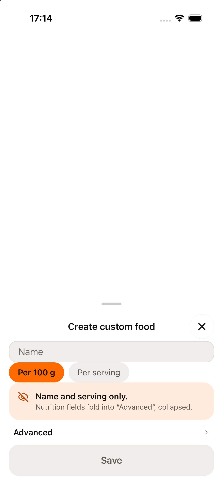 |

Frame: `docs/design/ember/frames/15-profile-food-search-ed-safe.png`. Screenshot: `docs/rn-migration/evidence/DY-04/u74-custom-food-ed-light.png`.
Deviations from the frame: Custom food with ED-Safe on (derived from frame 15): nutrition fields fold into a collapsed 'Advanced' group. The blur of the frame needs a package the app does not have: collapsed without blur. The sheet is a bottom card with a blank area above it; the frame is a full-height screen. A native formSheet route or a scrim token is needed and design/** is forbidden..

## profile: Food search (ED-Safe)

| Ember frame | RN on the Simulator |
|---|---|
|  |  |

Frame: `docs/design/ember/frames/15-profile-food-search-ed-safe.png`. Screenshot: `docs/rn-migration/evidence/DY-04/u74-custom-food-sheet.png`.
Deviations from the frame: Custom food, ED-Safe off (derived from frame 15): nutrition fields visible. The sheet is a bottom card with a blank area above it; the frame is a full-height screen. A native formSheet route or a scrim token is needed and design/** is forbidden..

## core: Today (light)

| Ember frame | RN on the Simulator |
|---|---|
| 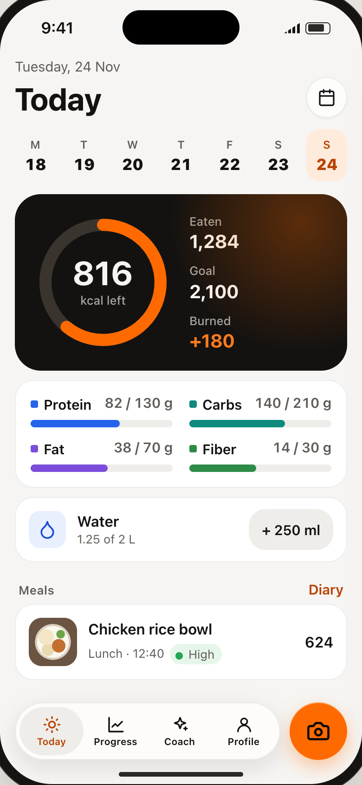 | 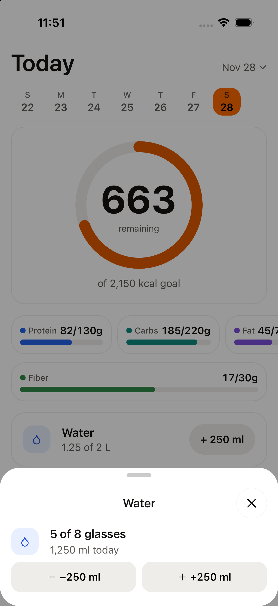 |

Frame: `docs/design/ember/frames/07-core-today-light.png`. Screenshot: `docs/rn-migration/evidence/DY-07/u74-water-sheet.png`.
Deviations from the frame: Water log sheet next to the water card of Today. Droplet tile and +/- 250 ml chips with the diary sheet chrome. The sheet is a bottom card with a blank area above it; the frame is a full-height screen. A native formSheet route or a scrim token is needed and design/** is forbidden..

## hc: Edit item (High Contrast light)

| Ember frame | RN on the Simulator |
|---|---|
| 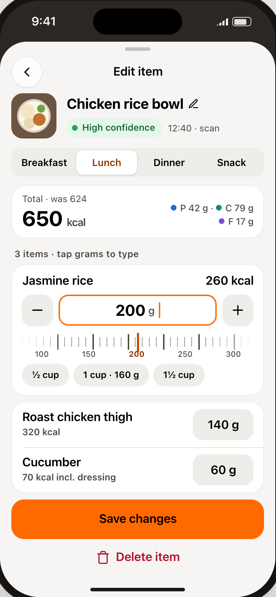 |  |

Frame: `docs/design/ember/frames/59-hc-edit-item-high-contrast-light.png`. Screenshot: `docs/rn-migration/evidence/DY-08/u74-edit-hc-light.png`.
Deviations from the frame: High Contrast: the setting was the Simulator's own (xcrun simctl ui increase_contrast enabled; switched off afterwards). Finding: the edit sheet changes subtly, the ruler ticks and the '350' label get darker; the layout does not change. The frame's stronger borders are not reproduced because the app reads no contrast setting..

## hc: Edit item (High Contrast dark)

| Ember frame | RN on the Simulator |
|---|---|
| 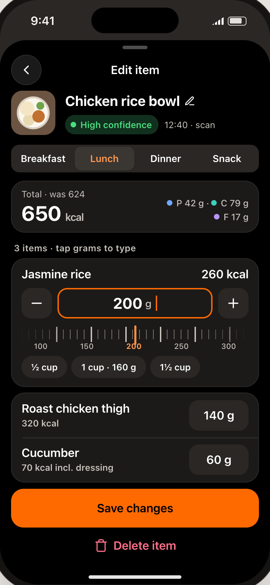 | 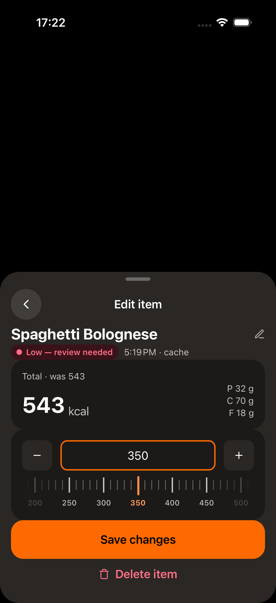 |

Frame: `docs/design/ember/frames/60-hc-edit-item-high-contrast-dark.png`. Screenshot: `docs/rn-migration/evidence/DY-08/u74-edit-hc-dark.png`.
Deviations from the frame: High Contrast, dark: the setting was the Simulator's own, switched off afterwards. Ruler ticks and label get lighter; layout unchanged. The app reads no contrast setting, so the frame's stronger borders are not reproduced..
