# Ember evidence of U-74

Every row puts the Ember frame next to the React Native screen on the iOS 26.4 Simulator.

## core: Diary day (sheet, large detent)

| Ember frame | RN on the Simulator |
|---|---|
|  | 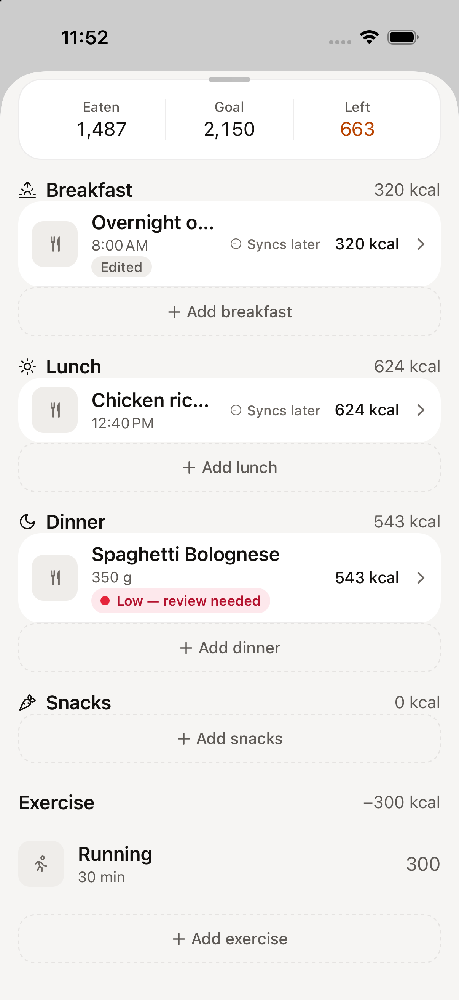 |

Frame: `docs/design/ember/frames/10-core-diary-day-sheet-large-detent.png`. Screenshot: `docs/rn-migration/evidence/DY-01/u74-diary-day-light.png`.
Deviations from the frame: the frame's close X beside the date pager is not built (the sheet dismisses by drag); the two sync-seeded rows carry the app's 'Syncs later' pending chip and the spike seed's derived 'Edited' chip (the sync store maps the mirror's createdAt from eatenAt, so updatedAt > createdAt reads as edited on a fresh seed — data-layer artifact, recorded not fixed); row titles truncate to one line under the chip and the kcal; the seeded day differs from the frame's sample (Overnight oats 320 kcal in Breakfast, Chicken rice bowl 624 in Lunch, Spaghetti Bolognese in Dinner, Running in Exercise).

## core: Diary day (sheet, large detent)

| Ember frame | RN on the Simulator |
|---|---|
|  | 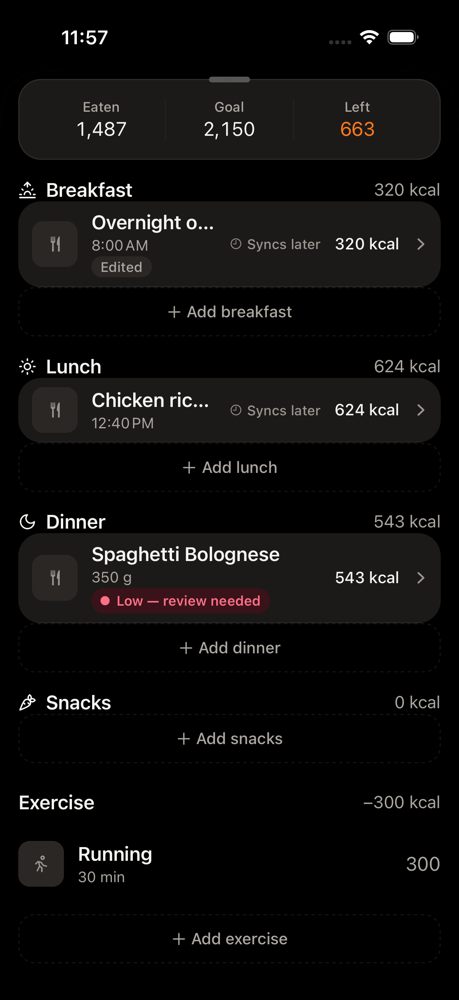 |

Frame: `docs/design/ember/frames/10-core-diary-day-sheet-large-detent.png`. Screenshot: `docs/rn-migration/evidence/DY-01/u74-diary-day-dark.png`.
Deviations from the frame: the dark variant of the row above; dark rides the tokens (no dark diary frame exists — the frame 10 is the derivation base).

## core: Diary day (sheet, large detent)

| Ember frame | RN on the Simulator |
|---|---|
|  |  |

Frame: `docs/design/ember/frames/10-core-diary-day-sheet-large-detent.png`. Screenshot: `docs/rn-migration/evidence/DY-02/u74-add-food-sheet.png`.
Deviations from the frame: derived: no add-food frame exists; the sheet follows the diary day sheet's tokens (frame 10 is the sheet it opens from) — five quick-action tiles over the saved-meals rail.

## profile: Food search (ED-Safe)

| Ember frame | RN on the Simulator |
|---|---|
|  |  |

Frame: `docs/design/ember/frames/15-profile-food-search-ed-safe.png`. Screenshot: `docs/rn-migration/evidence/DY-03/u74-food-search-ed-light.png`.
Deviations from the frame: the query is 'rice' (3 catalog rows) where the frame draws 'salmon' (4 rows with brand captions); the brand captions are not built — the catalog rows carry no brand field; the caret stays in the field after the keyboard dismisses.

## darkmore: Food search (dark, ED-Safe)

| Ember frame | RN on the Simulator |
|---|---|
| 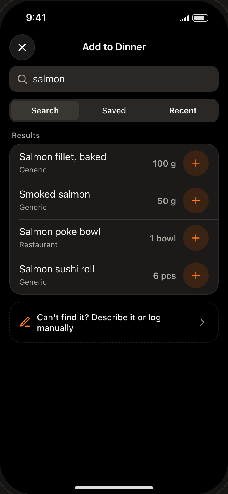 | 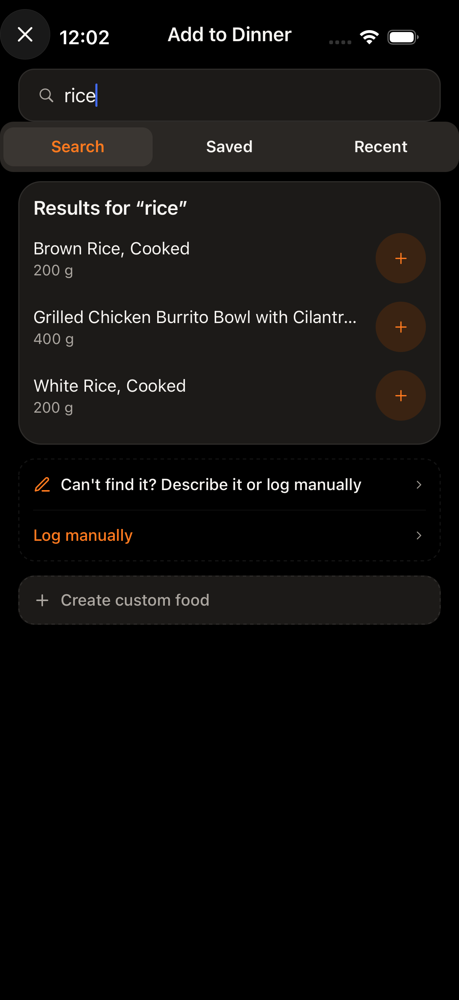 |

Frame: `docs/design/ember/frames/83-darkmore-food-search-dark-ed-safe.png`. Screenshot: `docs/rn-migration/evidence/DY-03/u74-food-search-ed-dark.png`.
Deviations from the frame: the dark variant of the search row above; the same query and data notes.

## profile: Food search (ED-Safe)

| Ember frame | RN on the Simulator |
|---|---|
|  |  |

Frame: `docs/design/ember/frames/15-profile-food-search-ed-safe.png`. Screenshot: `docs/rn-migration/evidence/DY-03/u74-food-search-off-light.png`.
Deviations from the frame: the mode-off state: the frame draws the ED-safe variant, so this row differs by the mode itself — the kcal footnote (123 kcal · 3g protein · 100g) shows in the serving slot, exactly the app's off behaviour.

## profile: Manual log (ED-Safe)

| Ember frame | RN on the Simulator |
|---|---|
| 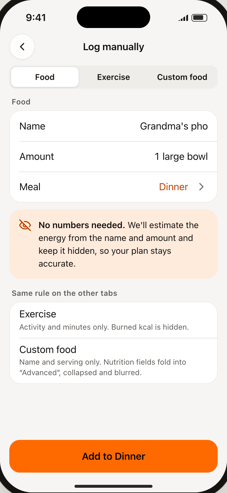 |  |

Frame: `docs/design/ember/frames/16-profile-manual-log-ed-safe.png`. Screenshot: `docs/rn-migration/evidence/DY-05/u74-manual-log-ed-light.png`.
Deviations from the frame: the frame draws the 'Log manually' screen (Food/Exercise/Custom-food segment, Name/Amount/Meal fields, the 'Same rule on the other tabs' list); the RN manual log is row-driven and opens from a search row ('Log White Rice, Cooked') — the segment screen stays with the owner's segment follow-up; the ED-safe note card and the derived-kcal rule match.

## darkmore: Manual log (dark, ED-Safe)

| Ember frame | RN on the Simulator |
|---|---|
|  |  |

Frame: `docs/design/ember/frames/84-darkmore-manual-log-dark-ed-safe.png`. Screenshot: `docs/rn-migration/evidence/DY-05/u74-manual-log-ed-dark.png`.
Deviations from the frame: the dark variant of the manual-log row above.

## profile: Manual log (ED-Safe)

| Ember frame | RN on the Simulator |
|---|---|
|  |  |

Frame: `docs/design/ember/frames/16-profile-manual-log-ed-safe.png`. Screenshot: `docs/rn-migration/evidence/DY-05/u74-manual-log-off-light.png`.
Deviations from the frame: the mode-off state: the kcal stepper (grams-worded, DS ccstepper strings) shows where the frame's ED-safe note card sits.

## diaryedit: Edit item (light)

| Ember frame | RN on the Simulator |
|---|---|
|  |  |

Frame: `docs/design/ember/frames/29-diaryedit-edit-item-light.png`. Screenshot: `docs/rn-migration/evidence/DY-08/u74-edit-light.png`.
Deviations from the frame: the meal segment (Breakfast/Lunch/Dinner/Snack), the meal thumbnail and the per-item breakdown ('3 items · tap grams to type') are not built — a diary entry edits as one item; serving chips none (the detail payload has none); the data differs: the seeded Spaghetti Bolognese (350 g, 'Low — review needed', '11:15 AM · cache') where the frame draws Chicken rice bowl (High confidence, 12:40 · scan).

## diaryedit: Edit item (dark)

| Ember frame | RN on the Simulator |
|---|---|
|  |  |

Frame: `docs/design/ember/frames/30-diaryedit-edit-item-dark.png`. Screenshot: `docs/rn-migration/evidence/DY-08/u74-edit-dark.png`.
Deviations from the frame: the dark variant of the edit row above; dark rides the tokens.

## diaryedit: Edit item (ED-Safe)

| Ember frame | RN on the Simulator |
|---|---|
|  | 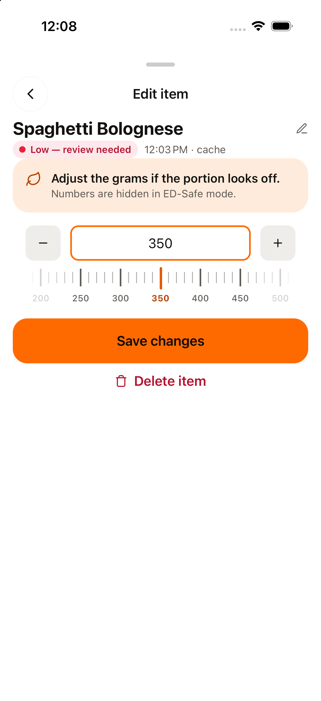 |

Frame: `docs/design/ember/frames/31-diaryedit-edit-item-ed-safe.png`. Screenshot: `docs/rn-migration/evidence/DY-08/u74-edit-ed.png`.
Deviations from the frame: under ED-Safe the total card collapses into the leaf note ('Adjust the grams if the portion looks off.' / 'Numbers are hidden in ED-Safe mode.') exactly as the frame; the frame's 'was 180 g' grams caption is not built (needs EdSafeAlternate, findings §9).

## hc: Edit item (High Contrast light)

| Ember frame | RN on the Simulator |
|---|---|
|  | 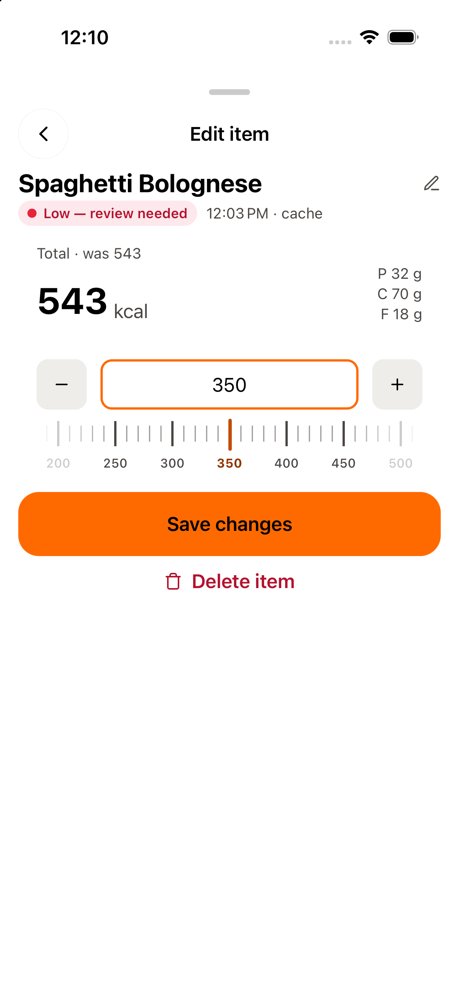 |

Frame: `docs/design/ember/frames/59-hc-edit-item-high-contrast-light.png`. Screenshot: `docs/rn-migration/evidence/DY-08/u74-edit-hc-light.png`.
Deviations from the frame: captured with xcrun simctl ui increase_contrast enabled (the switch the runtime offers).

## diaryedit: Delete confirm (light)

| Ember frame | RN on the Simulator |
|---|---|
|  | 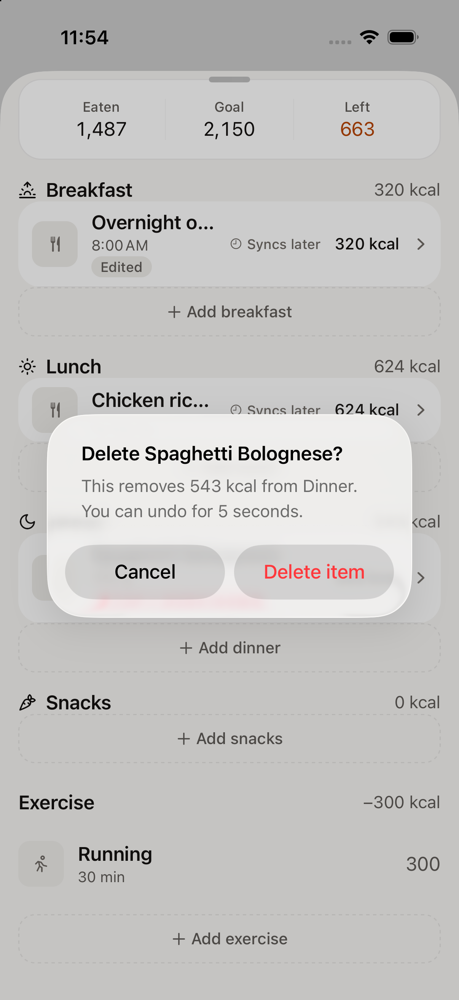 |

Frame: `docs/design/ember/frames/32-diaryedit-delete-confirm-light.png`. Screenshot: `docs/rn-migration/evidence/DY-08/u74-delete-light.png`.
Deviations from the frame: the same system action sheet (ActionSheetIOS) with the frame's copy ('Delete …?', 'This removes … kcal from …', 'You can undo for 5 seconds.', destructive Delete item + Cancel), captured over the day sheet via the row's long-press — the frame's backdrop is the edit sheet (triggering the sheet from the edit sheet's unmount swallows the presentation on this iOS); iOS 26 draws the two buttons side-by-side where the frame stacks them; the data reads the seeded Spaghetti Bolognese (543 kcal from Dinner).

## diaryedit: Delete confirm (dark)

| Ember frame | RN on the Simulator |
|---|---|
| 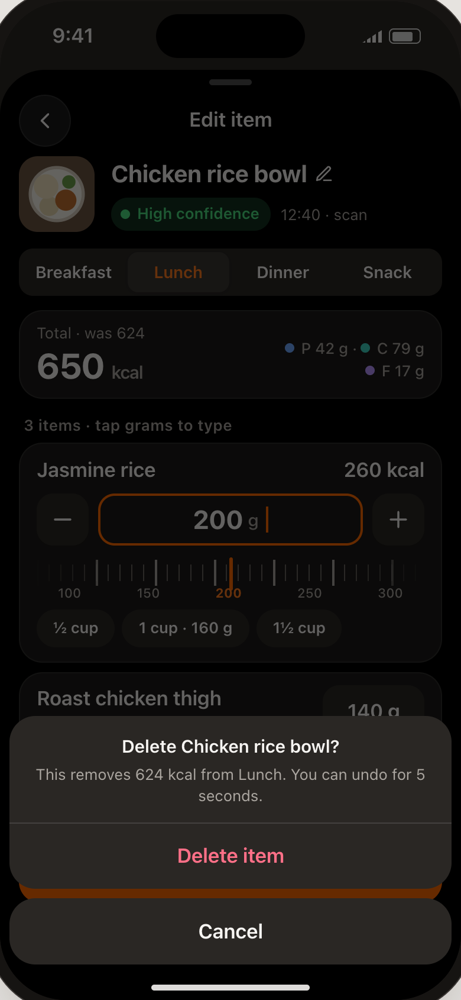 | 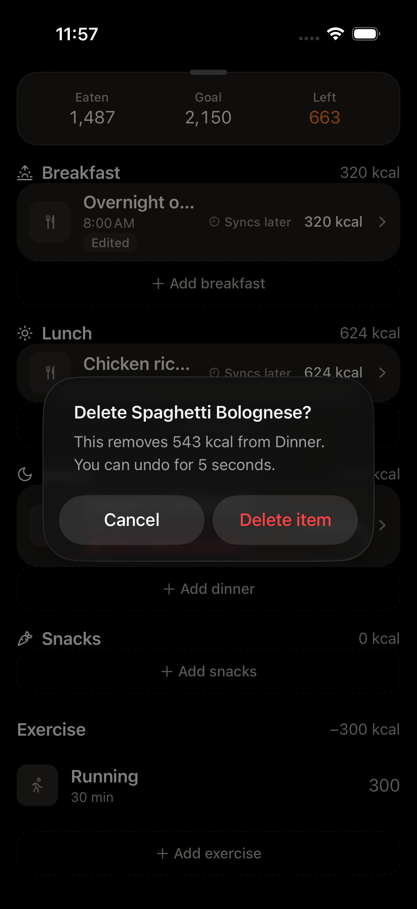 |

Frame: `docs/design/ember/frames/33-diaryedit-delete-confirm-dark.png`. Screenshot: `docs/rn-migration/evidence/DY-08/u74-delete-dark.png`.
Deviations from the frame: the dark variant of the delete row above.

## diaryedit: Delete confirm (ED-Safe)

| Ember frame | RN on the Simulator |
|---|---|
|  | 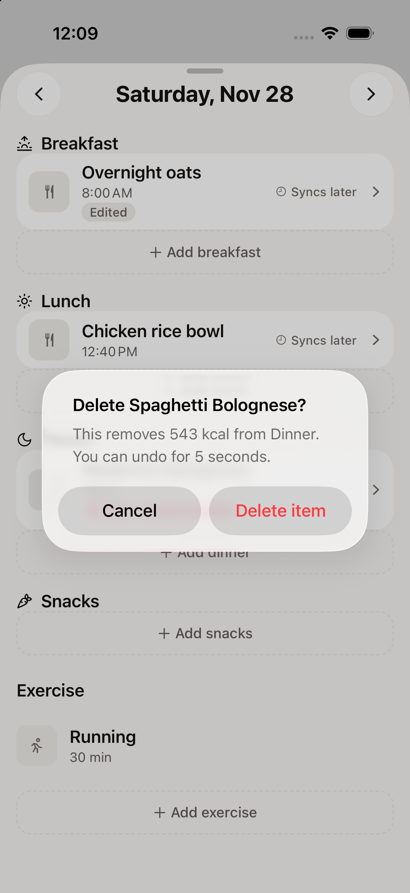 |

Frame: `docs/design/ember/frames/34-diaryedit-delete-confirm-ed-safe.png`. Screenshot: `docs/rn-migration/evidence/DY-08/u74-delete-ed.png`.
Deviations from the frame: the ED-Safe variant of the delete row above.

## diaryedit: Saved (light)

| Ember frame | RN on the Simulator |
|---|---|
|  | 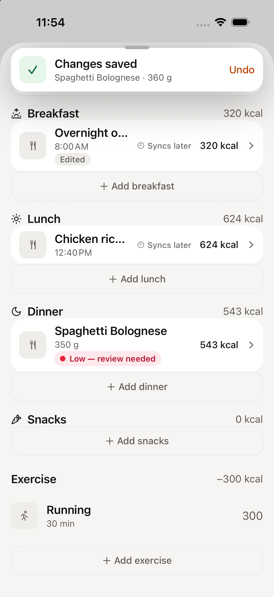 |

Frame: `docs/design/ember/frames/35-diaryedit-saved-light.png`. Screenshot: `docs/rn-migration/evidence/DY-08/u74-saved-light.png`.
Deviations from the frame: the toast reads 'Changes saved / Spaghetti Bolognese · 360 g' with the Undo chip as the frame; the DS Toast renders at the top of the sheet where the frame draws it at the bottom; the frame's accent-tinted row and inline 'Edited' label render as the chip under the row (the DS FoodRow chip slot) and the tint is not built.

## diaryedit: Saved (dark)

| Ember frame | RN on the Simulator |
|---|---|
| 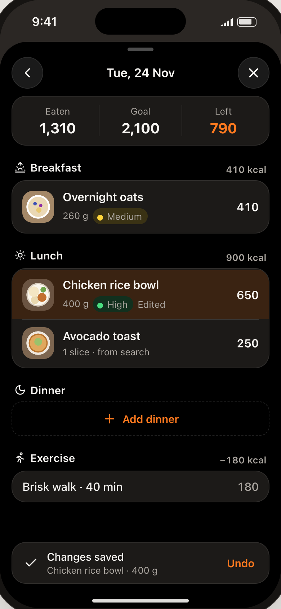 |  |

Frame: `docs/design/ember/frames/36-diaryedit-saved-dark.png`. Screenshot: `docs/rn-migration/evidence/DY-08/u74-saved-dark.png`.
Deviations from the frame: the dark variant of the saved row above.

## diaryedit: Saved (ED-Safe)

| Ember frame | RN on the Simulator |
|---|---|
| 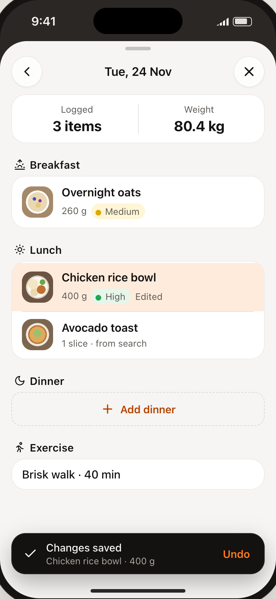 | 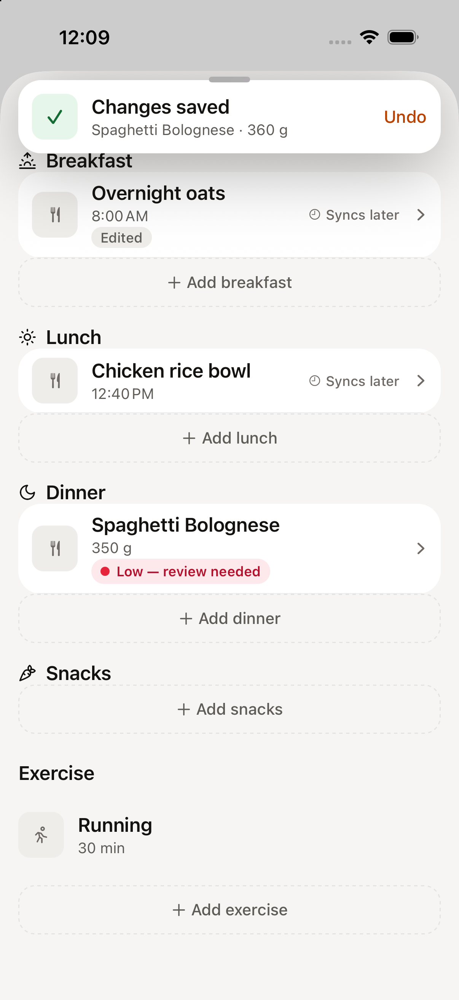 |

Frame: `docs/design/ember/frames/37-diaryedit-saved-ed-safe.png`. Screenshot: `docs/rn-migration/evidence/DY-08/u74-saved-ed.png`.
Deviations from the frame: the ED-Safe variant of the saved row above; the toast message is grams-and-names only, so it survives the mode.

## diaryedit: Deleted + Undo (light)

| Ember frame | RN on the Simulator |
|---|---|
|  | 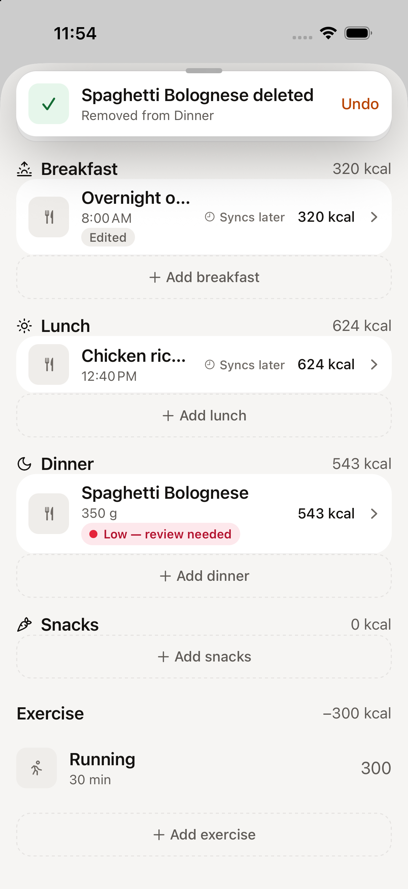 |

Frame: `docs/design/ember/frames/38-diaryedit-deleted-undo-light.png`. Screenshot: `docs/rn-migration/evidence/DY-08/u74-undo-light.png`.
Deviations from the frame: the toast reads 'Spaghetti Bolognese deleted / Removed from Dinner / Undo' — the frame's structure with the seeded names (the frame deletes Chicken rice bowl from Lunch); at capture time the day list still renders the deleted row — the tombstone and the toast are real (the transcript's waits) and the list re-renders the removal on the next notify, a beat after this shot.

## diaryedit: Deleted + Undo (dark)

| Ember frame | RN on the Simulator |
|---|---|
| 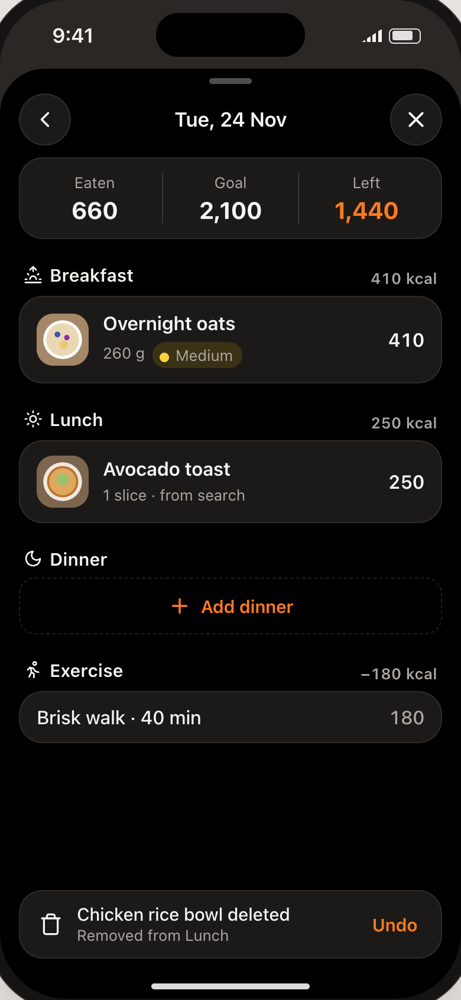 |  |

Frame: `docs/design/ember/frames/39-diaryedit-deleted-undo-dark.png`. Screenshot: `docs/rn-migration/evidence/DY-08/u74-undo-dark.png`.
Deviations from the frame: the dark variant of the deleted row above.

## diaryedit: Deleted + Undo (ED-Safe)

| Ember frame | RN on the Simulator |
|---|---|
| 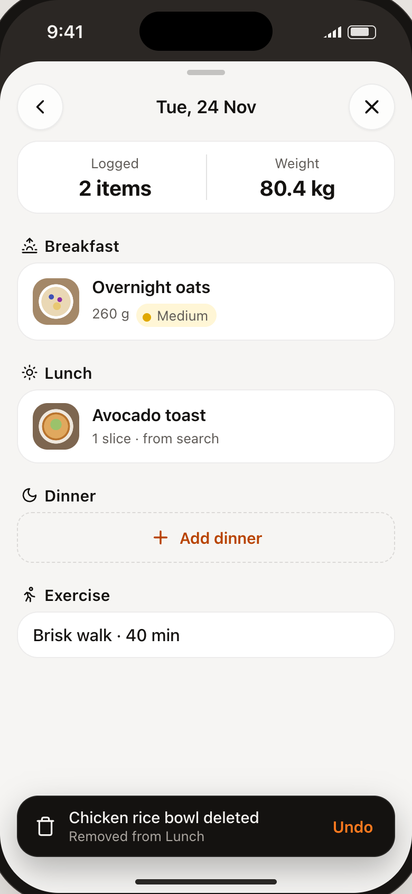 | 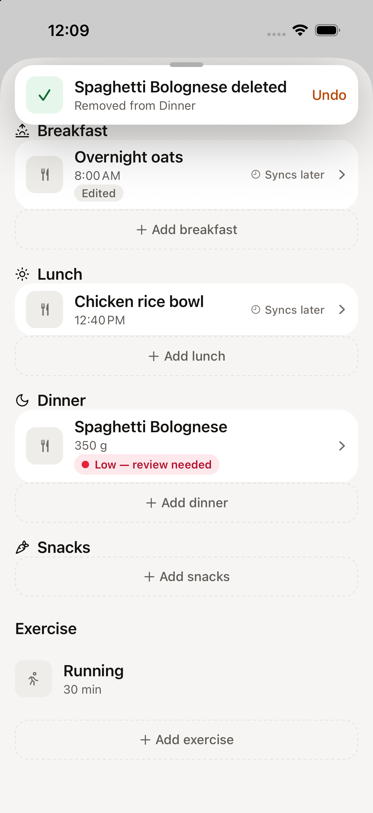 |

Frame: `docs/design/ember/frames/40-diaryedit-deleted-undo-ed-safe.png`. Screenshot: `docs/rn-migration/evidence/DY-08/u74-undo-ed.png`.
Deviations from the frame: the ED-Safe variant of the deleted row above.

## core: Diary day (sheet, large detent)

| Ember frame | RN on the Simulator |
|---|---|
|  | 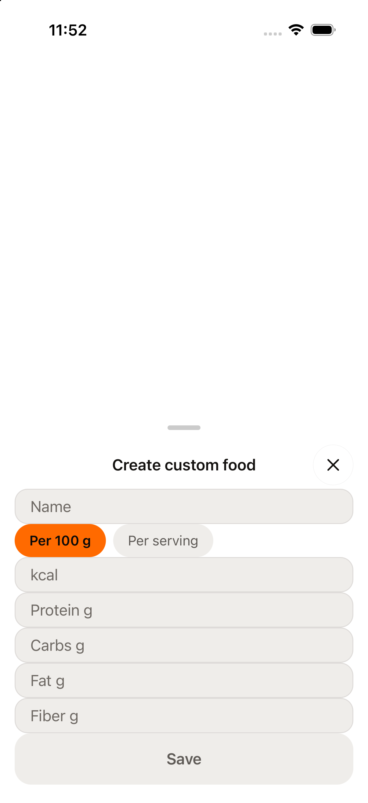 |

Frame: `docs/design/ember/frames/10-core-diary-day-sheet-large-detent.png`. Screenshot: `docs/rn-migration/evidence/DY-04/u74-custom-food-sheet.png`.
Deviations from the frame: derived: no custom-food frame exists (parity.tsv DY-04) — the sheet follows the diary day sheet's tokens; reached through the search screen's 'Create custom food'.

## core: Diary day (sheet, large detent)

| Ember frame | RN on the Simulator |
|---|---|
|  | 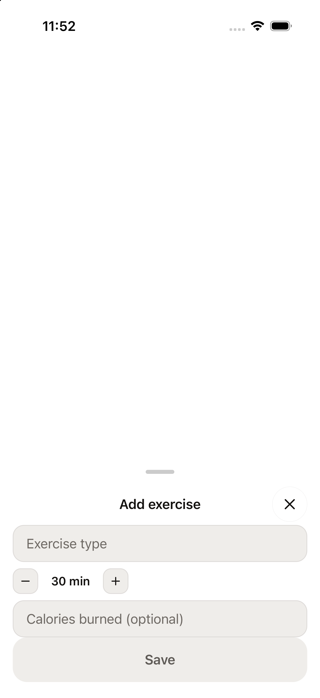 |

Frame: `docs/design/ember/frames/10-core-diary-day-sheet-large-detent.png`. Screenshot: `docs/rn-migration/evidence/DY-06/u74-exercise-sheet.png`.
Deviations from the frame: derived: no exercise frame exists (parity.tsv DY-06) — the sheet follows the diary day sheet's tokens; reached from the day sheet's Add exercise.

## core: Today (light)

| Ember frame | RN on the Simulator |
|---|---|
|  |  |

Frame: `docs/design/ember/frames/07-core-today-light.png`. Screenshot: `docs/rn-migration/evidence/DY-07/u74-water-sheet.png`.
Deviations from the frame: derived: the frame draws the water card on Today (07) and the RN sheet opens from that card; the sheet shows the glasses copy (5 of 8 glasses) while the Today card behind shows litres (1.25 of 2 L) — the U-71d behaviour.
