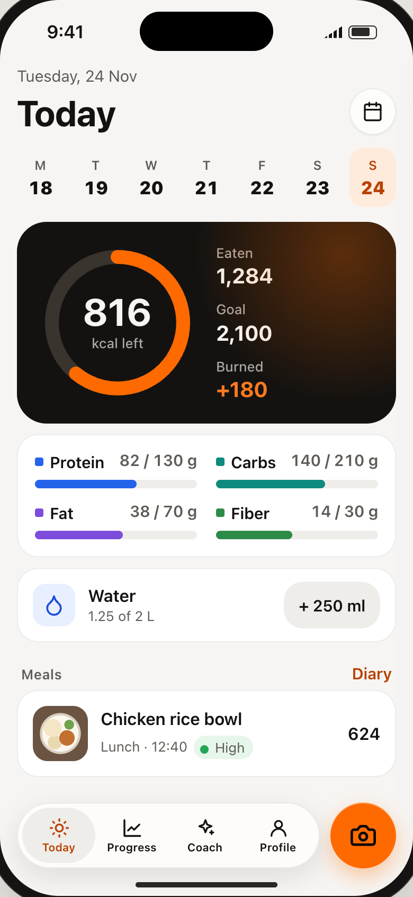
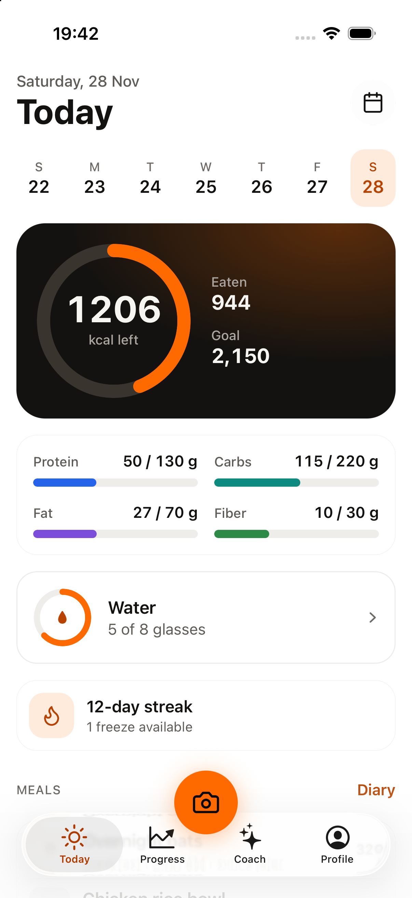
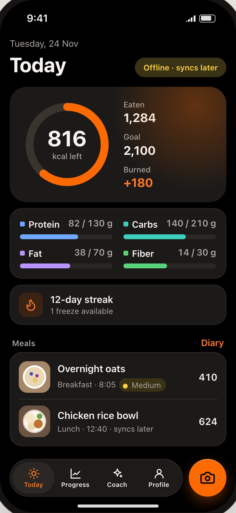
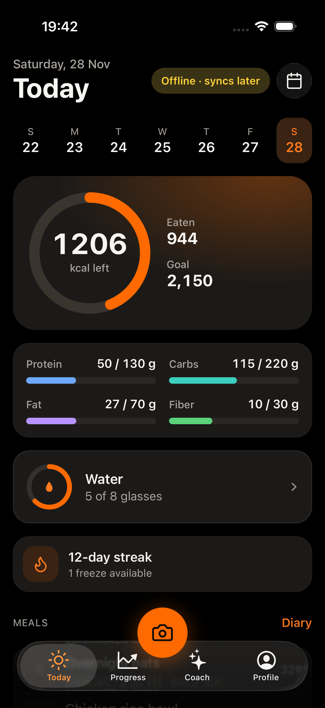
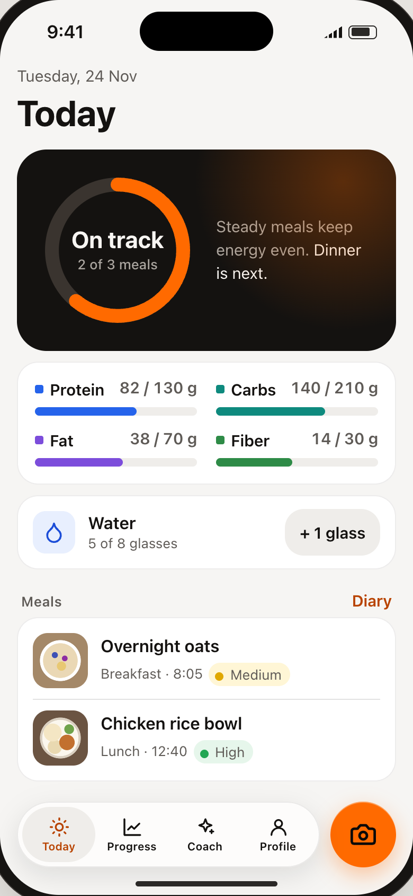
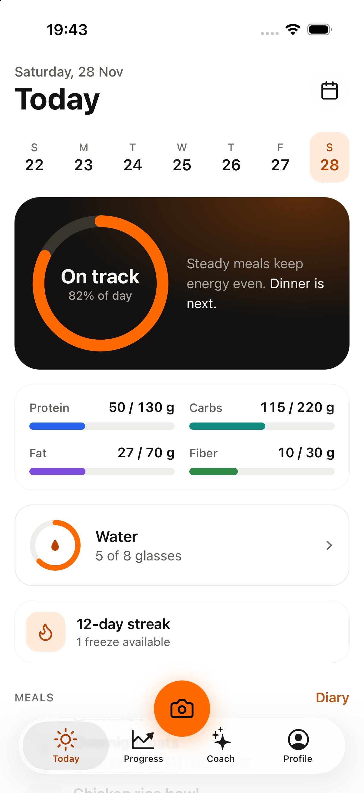
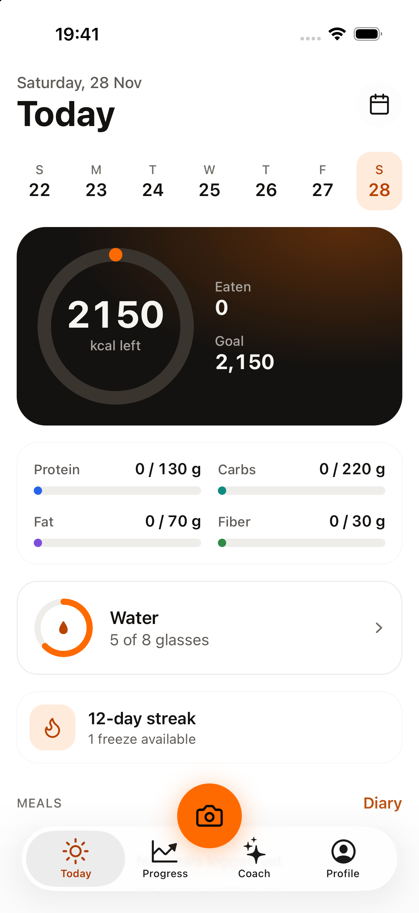
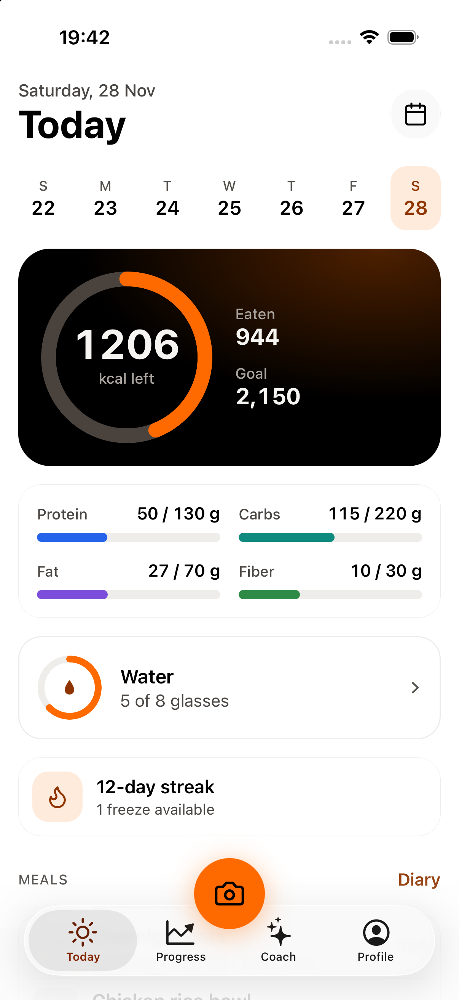

# Ember evidence of U-76

Every row puts the Ember frame next to the React Native screen on the iOS 26.4 Simulator.

## core: Today (light)

| Ember frame | RN on the Simulator |
|---|---|
|  |  |

Frame: `docs/design/ember/frames/07-core-today-light.png`. Screenshot: `docs/rn-migration/evidence/TD-01/u76e-today-light.png`.
Deviations from the frame: the RN screen draws a week strip (Sunday first; frame 07 starts on Monday; frames 08 and 09 have none) and a water card read from the diary (5 of 8 glasses, a ring and a chevron, no + button); the streak card is drawn in every state (frame 07 has none); meal rows hold a fork-and-knife tile where the frames have a photo and draw no confidence chip (Medium, High); no Burned figure and no N of M meals, because nothing is drawn without a source; the status bar shows the real clock; the section title is upper-case MEALS; the meals sit below the fold on this device. Meal rows draw the bare kcal number with no chevron, as in frame 07 (changed in this unit; the meals are in docs/rn-migration/evidence/TD-01/u76e-today-light-meals.png). Proof 2, macro grid (2 x 2: Protein, Carbs, Fat, Fiber): the four cards sit at x 32.3..193.0 and 209.0..369.7 pt of the 402 pt screen (from the accessibility dump), so none is cut at the edge. Proof 1 with 1206 kcal left: the ring number is one line, 88.0 pt wide.

## core: Today (dark, offline)

| Ember frame | RN on the Simulator |
|---|---|
|  |  |

Frame: `docs/design/ember/frames/08-core-today-dark-offline.png`. Screenshot: `docs/rn-migration/evidence/TD-01/u76e-today-dark-offline.png`.
Deviations from the frame: Launched with --ccForceOffline on a dark Simulator. The chip 'Offline · syncs later' sits beside the glass diary button, not under the title (decision of the brief, recorded deviation from frame 08). the RN screen draws a week strip (Sunday first; frame 07 starts on Monday; frames 08 and 09 have none) and a water card read from the diary (5 of 8 glasses, a ring and a chevron, no + button); the streak card is drawn in every state (frame 07 has none); meal rows hold a fork-and-knife tile where the frames have a photo and draw no confidence chip (Medium, High); no Burned figure and no N of M meals, because nothing is drawn without a source; the status bar shows the real clock; the section title is upper-case MEALS; the meals sit below the fold on this device. Proof 2, macro grid (2 x 2: Protein, Carbs, Fat, Fiber): the four cards sit at x 32.3..193.0 and 209.0..369.7 pt of the 402 pt screen (from the accessibility dump), so none is cut at the edge (dark). Proof 1 in dark with 1206 kcal left: one line, 88.0 pt wide. Third look, the header offline (crop: docs/rn-migration/evidence/TD-01/u76e-header-offline.png; light chip: docs/rn-migration/evidence/TD-01/u76e-today-light-offline.png): 'Saturday, 28 Nov' stays on one line in a 163 pt column, ending near x 136 pt; the chip is 146.7 pt wide at x 187.3 and the diary button 44 pt at x 342, so about 51 pt separate the date from the chip. The date is not crowded on this device, but the row is full: a longer date or chip text would not fit.

## core: Today (ED-Safe)

| Ember frame | RN on the Simulator |
|---|---|
|  |  |

Frame: `docs/design/ember/frames/09-core-today-ed-safe.png`. Screenshot: `docs/rn-migration/evidence/TD-01/u76e-today-ed-safe.png`.
Deviations from the frame: Launched with --ccEDSafe. No number left (the ring is not in the accessibility dump); the ring reads 'On track' and '82% of day' (from the clock) where the frame reads '2 of 3 meals', and the sentence 'Steady meals keep energy even. Dinner is next.' is the same. Macro numbers stay, as in the frame. the RN screen draws a week strip (Sunday first; frame 07 starts on Monday; frames 08 and 09 have none) and a water card read from the diary (5 of 8 glasses, a ring and a chevron, no + button); the streak card is drawn in every state (frame 07 has none); meal rows hold a fork-and-knife tile where the frames have a photo and draw no confidence chip (Medium, High); no Burned figure and no N of M meals, because nothing is drawn without a source; the status bar shows the real clock; the section title is upper-case MEALS; the meals sit below the fold on this device. Proof 2, macro grid (2 x 2: Protein, Carbs, Fat, Fiber): the four cards sit at x 32.3..193.0 and 209.0..369.7 pt of the 402 pt screen (from the accessibility dump), so none is cut at the edge (ED-Safe).

## core: Today (light)

| Ember frame | RN on the Simulator |
|---|---|
|  |  |

Frame: `docs/design/ember/frames/07-core-today-light.png`. Screenshot: `docs/rn-migration/evidence/TD-01/u76e-empty-light.png`.
Deviations from the frame: Derived row, no frame of the empty day exists: the demo persona (goal 2150) after the Debug console action reset, so Eaten 0 and 'No meals logged yet'. Proof 1: with nothing eaten and the four-digit goal, the ring number '2150' sits on ONE line (one text band, 26.0 pt high) and is 90.3 pt wide, centred (x 66.0..156.0 pt in a ring spanning x 36..186), which is 60% of the 150 pt ring and 73% of the 124 pt inside the stroke; the caption 'kcal left' (47.0 pt wide) is under it. Same in dark (docs/rn-migration/evidence/TD-01/u76e-empty-dark.png): 90.3 pt, one line. Proof 2, macro grid (2 x 2: Protein, Carbs, Fat, Fiber): the four cards sit at x 32.3..193.0 and 209.0..369.7 pt of the 402 pt screen (from the accessibility dump), so none is cut at the edge (light). Other differences as in row 07.

## core: Today (light)

| Ember frame | RN on the Simulator |
|---|---|
|  |  |

Frame: `docs/design/ember/frames/07-core-today-light.png`. Screenshot: `docs/rn-migration/evidence/TD-01/u76e-today-high-contrast.png`.
Deviations from the frame: Derived row: increase_contrast enabled on the Simulator (xcrun simctl ui), shot, then disabled. At this scale the screen shows no visible change from row 07, and I did not verify that the app reads the setting. Proof 2, macro grid (2 x 2: Protein, Carbs, Fat, Fiber): the four cards sit at x 32.3..193.0 and 209.0..369.7 pt of the 402 pt screen (from the accessibility dump), so none is cut at the edge (High Contrast). Other differences as in row 07; frame 07 is the light reference, no High Contrast frame exists.
